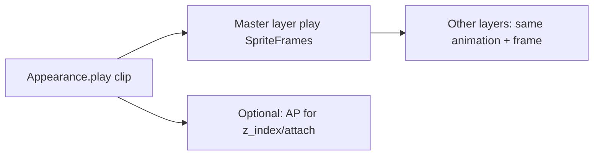

# Plan — CharacterAppearance / Animation Refactor

Abhak-Liste nach Review von Layer-Sync und AnimationPlayer: **ein Taktgeber**, weniger Duplikat-Tracks, Layers bleiben.

Bezug:
- Cleanup: [`PLAN_CHARACTER_NPC_CLEANUP.md`](PLAN_CHARACTER_NPC_CLEANUP.md)
- Szene: [`scenes/characters/character_appearance.tscn`](../scenes/characters/character_appearance.tscn) (~1900 Zeilen Anim-Tracks)
- Script: [`scripts/characters/character_appearance.gd`](../scripts/characters/character_appearance.gd)
- Content: `features/character/**/*.tres` (SpriteFrames mit `idle_*` / `walk_*` / `*_battle`)

Reihenfolge: Zielmodell festnageln → Runtime `play` umstellen → AnimationPlayer entschlacken → Script/Content trennen → Kurztest.

---

## 0. Leitplanken

| # | Entscheidung |
|---|--------------|
| 1 | Layer-Modell bleibt (Race/Body/Hair/Head/Leg/Weapons) |
| 2 | Clip-Namen bleiben kanonisch: `idle_front`, `walk_left`, … (inkl. `_battle` wo Content existiert) |
| 3 | **Ein** Frame-Takt: SpriteFrames-Playback; keine parallelen Frame-Keyframes pro Layer im AnimationPlayer |
| 4 | AnimationPlayer optional nur für Non-Frame (Attachment-Pos, z_index, Sichtbarkeit) — oder vorerst ganz ungenutzt für Idle/Walk |
| 5 | Public API bleibt: `play`, `set_*`, `apply_full_data`, `get_full_data` (Call-Sites unverändert) |
| 6 | Kein Gear-System in diesem Plan — nur Anim-Pipeline |



- [x] Leitplanken in Status kurz verlinken

---

## 1. Ist-Probleme (kurz)

- AnimationPlayer setzt `animation` + `frame` auf jedem Layer → Timing doppelt zu `.tres`-Clips
- Neue Anim = viele Tracks kopieren; Drift-Risiko bei Layer-Swap (mitigiert durch Resync, aber Architektur bleibt schwer)
- `HandSprite2D` / Waffen nicht konsistent in Script-`layers`
- Script mischt Visual-Runtime und Creation-Katalog (`load_files`)

---

## 2. Ziel-Runtime

### 2.1 `play(clip)` ohne Frame-Tracks

```text
play("walk_front"):
  for each visible body layer with sprite_frames.has_animation(clip):
    layer.animation = clip
    layer.play(clip)          # oder frame sync vom Master
  keep frame index aligned (master = Race2DSprite or first available)
```

Variante A (empfohlen v1): **Master-Layer** (`Race2DSprite`) spielt; `_process`/`frame_changed` spiegelt `frame` + `animation` auf Body/Hair/Leg/Head (sichtbare Layer).  
Variante B: alle Layer `.play(clip)` gleichzeitig (SpriteFrames müssen gleiche Frame-Counts haben — heute meist der Fall).

**Entscheidung v1:** Variante B zuerst (einfacher); wenn Drift zwischen Assets auftritt → Variante A nachziehen.

- [ ] `CharacterAppearance.play` auf SpriteFrames-Playback umstellen
- [ ] Layer-`autoplay` dauerhaft aus (Szene + Runtime)
- [ ] `_resync_animation` an neues Modell anpassen (gemeinsamer Clip + Frame 0 oder Master-Frame)
- [ ] FSM Idle/Walk / NPC Anim-RPCs unverändert `play("idle_front")` etc. nutzen

### 2.2 AnimationPlayer-Rolle

- Idle/Walk: **keine** Frame-Tracks mehr nötig
- Battle-Anims / Weapon z_index: später eigene schlanke Library **oder** weiter SpriteFrames-only bis Content braucht Attachment-Keys

- [ ] Idle/Walk-Frame-Tracks aus Nutzung nehmen (Playback nicht mehr über AP)
- [ ] Optional: AP-Library auf Non-Frame reduzieren oder AP-Node belassen aber ungenutzt für Movement (kein big-bang Delete der `.tscn`-Anims in Slice 1)

**Entscheidung Slice 1:** Runtime umstellen; alte AP-Anims in der Szene **erst belassen** (Rollback), in Slice 2 entfernen/archivieren.

---

## 3. Szene / Layers aufräumen

- [ ] `HandSprite2D` in Layer-Liste oder bewusst als Battle-only dokumentieren
- [ ] Waffen-Marker: Visibility über `apply_full_data` / Gear-Keys, nicht feste Szenen-Defaults die Creation stören
- [ ] Editor-Defaults: einheitlich `idle_front`, kein widersprüchliches `walk_back` + `frame = 1` auf Preview-Layern
- [ ] Slice 2: ungenutzte Idle/Walk-AP-Animationen aus `.tscn` löschen (Datei massiv schrumpfen)

---

## 4. Script-Schnitt Creation vs Runtime

- [ ] Katalog-Loading (`load_files` / `raceSprites` …) aus `CharacterAppearance` in kleinen Helper ziehen (z. B. `AppearanceCatalog` oder nur in `character_creation.gd`)
- [ ] Ingame-`CharacterAppearance._ready` lädt keine Creation-Ordner mehr

---

## 5. Empfohlene Reihenfolge

1. Leitplanken + dieser Plan  
2. **Runtime `play` → SpriteFrames** (+ Resync anpassen); Smoke Creation + Overworld Walk  
3. Layer/Hand/Defaults in Szene glätten  
4. Creation-Katalog aus Appearance-Script ziehen  
5. AP Idle/Walk-Tracks aus `.tscn` entfernen  
6. Kurztest + Status/README  

---

## Kurztest

- [ ] Charaktererstellung: Layer wechseln → kein Frame-Drift
- [ ] Overworld: Idle↔Walk 4 Richtungen; Multiplayer Anim-RPC weiterhin ok
- [ ] Fight: Party/Enemy Appearance `apply_full_data` + idle
- [ ] NPC Slime (nur Race-Layer) spielt ohne Fehler
- [ ] Nach Track-Delete: keine fehlenden `has_animation`-Crashes (play fällt auf SpriteFrames zurück)

---

## Definition of Done

- [ ] Movement-Anims laufen ohne AnimationPlayer-Frame-Tracks
- [ ] Public Appearance-API unverändert für Call-Sites
- [ ] `.tscn` deutlich schlanker (nach Slice 2) oder zumindest Runtime unabhängig von den Tracks
- [ ] Creation-Katalog nicht mehr Pflicht in jedem Appearance-`_ready`

---

## Verweise

- Cleanup: [`PLAN_CHARACTER_NPC_CLEANUP.md`](PLAN_CHARACTER_NPC_CLEANUP.md)
- Status: [`project_current_state_v_2.md`](project_current_state_v_2.md)
