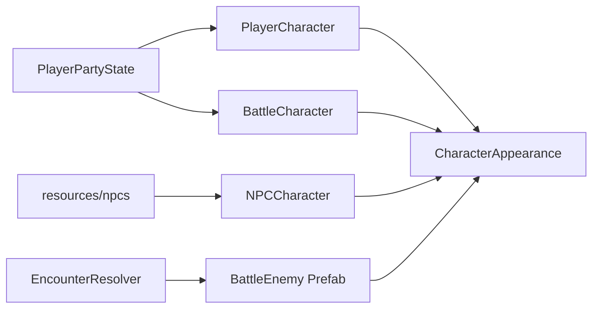

# Plan — Character / NPC / Enemy Cleanup

Abhak-Liste nach Review der Spieler-, NPC- und Enemy-Pipelines: **abläufe verfestigen, Duplikate reduzieren, Totpfade entfernen** — ohne Overworld und Fight zusammenzulegen.

Bezug:
- Party/Group/Encounter: [`PLAN_PARTY_GROUP_ENCOUNTER.md`](PLAN_PARTY_GROUP_ENCOUNTER.md)
- Kampf: [`PLAN_KAMPFSYSTEM_GRID.md`](PLAN_KAMPFSYSTEM_GRID.md)
- Status: [`project_current_state_v_2.md`](project_current_state_v_2.md)
- Coding-Rules: [`.cursor/rules/godot-coding-standards.mdc`](../.cursor/rules/godot-coding-standards.mdc)

Kernszenen:
- Player: `scenes/characters/player_character.tscn` → `scripts/characters/player_character.gd`
- Appearance: `scenes/characters/character_appearance.tscn`
- NPC: `scenes/characters/npc_character.tscn` + Specs unter `scenes/characters/npc_specifications/`
- Battle Player: `scenes/battle/battle_character.tscn`
- Battle Enemies: Spawn in `scripts/battle/fight_template.gd` (`_spawn_battle_enemies`)

Reihenfolge: P1 Korrektheit/Netz → Appearance/Loader → Prefabs/Struktur → Aufräumen → Kurztest.

---

## 0. Leitplanken (verbindlich)

| # | Entscheidung |
|---|--------------|
| 1 | Overworld-Player und `BattleCharacter` bleiben **getrennte** Nodes; shared ist nur `CharacterAppearance` + Dict-Schema |
| 2 | Overworld-NPC bleibt Map-Anker; Kampf-Enemies kommen aus Host-`enemy_roster` (nicht derselbe Node) |
| 3 | Kein großes Fight-Lock-Rewrite in diesem Plan — nur gezielte API-Löcher schließen |
| 4 | Keine neuen Spieler-Features (Loot-UI, Encounter-Symbol, Group-Auto-Fight) — nur Stabilität/Wartbarkeit |
| 5 | Debug-Strings dürfen EN bleiben; spielersichtbare Strings weiter über CSV/`tr()` |

- [x] Leitplanken in Status-Docs kurz vermerken (dieser Plan verlinkt)

---

## 1. P1 — Korrektheit / Netz (erster Slice)

Kleine, risikoarme Fixes mit direktem Effekt.

### 1.1 WalkState Anim-Gate

- Ist: `IdleState._emit_and_play` prüft `_last_anim`; `WalkState` nicht → RPC-Spam jedes Physik-Frame
- Soll: gleiches Gate wie Idle; `_last_anim` setzen

Dateien: [`scripts/characters/state/walk_state.gd`](../scripts/characters/state/walk_state.gd), [`idle_state.gd`](../scripts/characters/state/idle_state.gd)

- [x] `_emit_and_play` nur bei Anim-Wechsel
- [ ] Smoke: 2 Peers laufen → Anim-RPCs nicht mehr spam-artig

### 1.2 Player-Spawn-Name festziehen

- Ist: `MultiplayerSpawn._spawn_player` setzt kein `name`; Lookups oft `Players/<peer_id>`
- Soll: `p.name = str(peer_id)`; Lookups bevorzugt über `players[peer_id]`-Dict

Datei: [`features/multiplayer_spawner.gd`](../features/multiplayer_spawner.gd)

- [x] Explizites `p.name = str(peer_id)`
- [x] Kritische Lookups prüfen (Fight appearance collect, Join-Distanz, Autosave-Position) — Dict vor NodePath (`get_player` Helper; NodePath via fester Name)

### 1.3 NPC-Sync-Totpfad

- Ist: JSON `"isActice": "true"` (Typo + String); Code `isActive == true`; `set_npc_sync` fehlt → Crash-Risiko
- Soll: Zweig **reparieren oder entfernen** (Position läuft schon über `MultiplayerSynchronizer`)

**Entscheidung v1 dieses Plans:** Totpfad entfernen (kein paralleles `NPCSync`, solange Synchronizer reicht). Spec-Key bereinigen.

Dateien: [`specification_container.gd`](../scripts/characters/specification_container.gd), `resources/npcs/*.json`, ggf. `npc_sync.tscn` ungenutzt lassen/markieren

- [x] Sync-Zweig in `set_specifical_nodes` entfernen oder hinter korrektem Bool-Key + `set_npc_sync`-API
- [x] JSON-Key `isActice` entfernen oder zu dokumentiertem Schema (wenn Sync später zurückkommt)
- [x] Kein Crash mehr bei Spec-Load Hostile/Friendly

### 1.4 Patrol-API für Aggro

- Ist: `AggroController` ruft `stop_patrol` / `resume_patrol` per `has_method` — Methoden fehlen
- Soll: Methoden an `NPCCharacter` (Timer stoppen / Walk fortsetzen) **oder** Aufrufe streichen und nur State-Wechsel nutzen

**Entscheidung v1:** Methoden implementieren (klarer Vertrag mit AggroController).

Dateien: [`npc_character.gd`](../scripts/characters/npc_character.gd), [`aggro_controller.gd`](../scripts/characters/npc_specifications/aggro_controller.gd)

- [x] `stop_patrol()` / `resume_patrol()` implementieren
- [ ] Aggro → Chase → Timeout → Patrol funktioniert ohne stille No-Ops

---

## 2. P1.5 / P2 — Appearance & Archetyp-Loader

### 2.1 Appearance Single Collect

- Ist: Fallback-Kaskade doppelt in `FightManager._collect_player_appearance` und `FightTemplate._get_overworld_player_appearance`
- Soll: eine Hilfsfunktion (z. B. an `PlayerPartyState` oder kleinem Appearance-Helper): Sync → Save → Visual → Party-Leader

- [x] Gemeinsame Collect-API
- [x] FightManager + FightTemplate nutzen dieselbe Funktion
- [x] Creation schreibt Appearance konsistent in `party_data.members[leader]` (player_data nur Legacy/Fallback)

### 2.2 Appearance-Schema bewusst machen

- Ist: `get_full_data` / `apply_full_data` nur race/hair/body/leg — Head/Weapon bleiben Szenen-Defaults
- Soll: entweder Layer in Dict aufnehmen **oder** Battle-Defaults explizit ausblenden/dokumentieren

**Entscheidung v1:** Head/Hand/Weapon in Dict optional serialisieren wenn gesetzt; fehlende Keys → Layer unsichtbar (wie Spec-Apply beim NPC).

- [x] Schema erweitern oder Battle-Layer-Hide bei fehlenden Keys
- [ ] Kurztest: Overworld-Look ≈ Battle-Look (gleiche gesetzte Layer)

### 2.3 Gemeinsamer NPC-Archetyp-Loader

- Ist: `NpcSpecification.load_npc_enemy_data` und `EncounterResolver._load_npc_archetype` lesen JSON getrennt
- Soll: eine Loader-Funktion (Stats, Appearance, Loot, hostile, encounter-Felder)

- [x] Shared Loader (z. B. `NpcArchetype.load(npc_type) -> Dictionary`)
- [x] Spec + EncounterResolver verdrahten
- [x] Alte Specs (`group_size`, `encounter_id`, inline `units`) weiter lauffähig

---

## 3. P2 — Prefabs / Struktur

### 3.1 Battle-Enemy-Prefab

- Ist: `_spawn_battle_enemies` baut `Node2D.new()` + Appearance + Label
- Soll: kleine Szene/Script `BattleEnemy` (Appearance, Label, Meta `npc_type`/`stats`)

- [ ] Prefab + Spawn umstellen
- [ ] Turn-Controller / AI unverändert an `unit.node` angebunden

### 3.2 PlayerCharacter schlanker (gezielt)

- Ist: Fight-Gate jedes Physik-Frame via Tree-Pfad zu FightManager; viele Verantwortlichkeiten in einem Script
- Soll: Fight-Visibility über Signal/Callback vom FightManager (oder gecachte Ref); Interact bleibt, aber ohne neue Features

- [ ] Fight-World-Gate ohne Frame-Polling (Signal oder State-Flag)
- [ ] Keine Verhaltensänderung für Spieler (Appearance hide/show wie bisher)

### 3.3 Quest-Kill vs. Roster (Naht)

- Ist: Victory credited oft `amount: 1` trotz Composition mit N Units
- Soll: Kill-Credit an besiegte Units / Roster-Typen koppeln (oder bewusst 1× Map-Anker dokumentieren)

**Entscheidung v1:** Credit pro besiegtem Enemy-`npc_type` aus Roster (aggregiert), nicht pauschal 1.

- [ ] Victory-Kill-Credit an Roster anbinden
- [ ] Demo-Quest / F3-Smoke: Trio → passender Kill-Count

---

## 4. P3 — Aufräumen

- [ ] `character_appearance_old.gd` entfernen (falls unreferenziert)
- [ ] Legacy [`scripts/world/patrols/biom_1/patrol.gd`](../scripts/world/patrols/biom_1/patrol.gd) entfernen oder klar als unused markieren
- [ ] `_dir_name` / Snap: gemeinsame Utility (Player Idle/Walk; optional NPC später)
- [ ] `NPCController`-Exports mit Spec-Runtime zusammenführen oder Klasse streichen
- [ ] Character-Creation Inventory: `items: []` konsistent zum Normalizer
- [ ] Irreführende Debug-Prints in AggroArea entfernen (F3 bleibt EN)

---

## 5. Empfohlene Umsetzungsreihenfolge

1. **§1 P1** Walk-Gate + Spawn-Name + NPC-Sync-Totpfad + Patrol-API — erledigt (Smoke manuell)
2. **§2** Appearance-Collect + Schema + Archetyp-Loader — erledigt (Kurztest manuell)
3. **§3** Battle-Enemy-Prefab + Fight-Gate-Signal + Kill-Credit
4. **§4** Aufräumen
5. Kurztest + Status/README anpassen

---

## Nicht in diesem Plan

| Später | Naht hier |
|--------|-----------|
| Gefährten auf der Map | Appearance/Party-Daten schon kanonisch |
| Loot-UI aus `npc_loot` | Loader liefert Loot-Dict |
| Encounter-Symbol über Gegner | Map-NPC bleibt Anker |
| Group Auto-Fight | GroupManager unverändert |
| Stabile `spawn_id` statt nur NodePath | optional nach Prefab-Slice, wenn Lock/Remove wackelt |

---

## Kurztest-Checkliste

- [ ] 2 Peers: Laufen ohne Anim-RPC-Spam; Looks syncen weiter
- [ ] Player-Node unter `Players/<peer_id>`; Fight startet Appearance korrekt
- [ ] Hostile NPC: Aggro → Chase → Force-Fight → Lock; Leave → Unlock + Patrol
- [ ] Friendly NPC: Talk/Quest unverändert
- [ ] Fight: Party-Units + Enemy-Roster; Looks ohne Default-Waffen-Überraschung (nach §2.2)
- [ ] Encounter mit `units` count > 1: Spawn + Kill-Credit stimmig (nach §3.3)
- [ ] Spec nur `group_size` weiter kompatibel
- [ ] Keine Regression: Disconnect mid-fight, Late-Join Appearance

---

## Definition of Done

- [x] P1 (§1) ohne Net-/Crash-Totpfade
- [x] Appearance-Collect und Archetyp-Laden nicht mehr doppelt driftend
- [ ] Battle-Enemies über Prefab (kein ad-hoc `Node2D.new`-Haufen)
- [ ] Leitplanken eingehalten: OW ≠ Fight-Nodes
- [x] Status/README verlinken diesen Plan; erledigte Slices abgehakt

---

## Verweise

- Party/Group/Encounter: [`PLAN_PARTY_GROUP_ENCOUNTER.md`](PLAN_PARTY_GROUP_ENCOUNTER.md)
- Kampf: [`PLAN_KAMPFSYSTEM_GRID.md`](PLAN_KAMPFSYSTEM_GRID.md)
- Quests: [`PLAN_QUESTSYSTEM.md`](PLAN_QUESTSYSTEM.md)
- Status: [`project_current_state_v_2.md`](project_current_state_v_2.md)
