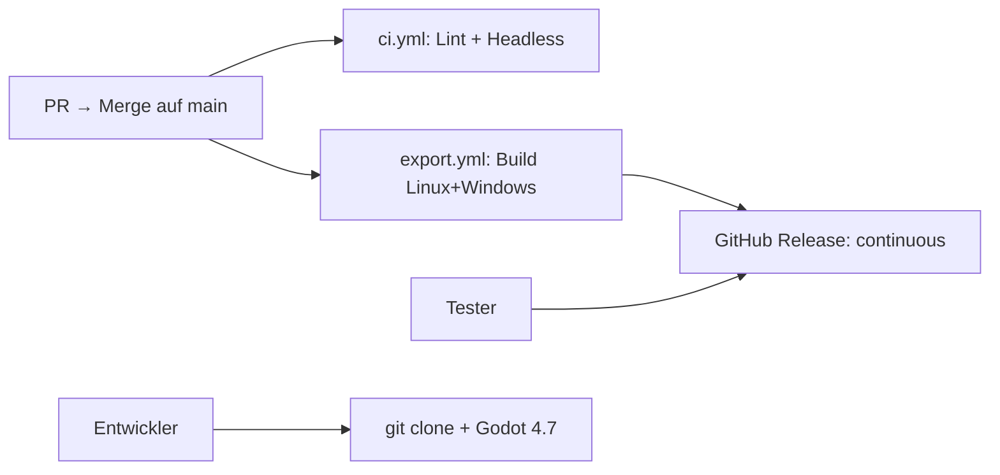

# Plan — CI Export Builds (Spielen ohne Godot-Installation)

Abhak-Liste: Fertige Spiel-Builds (Linux + Windows) per GitHub Actions erzeugen und als Download bereitstellen, damit Tester **ohne Godot-Editor** spielen können. Quellcode-Clone bleibt Editor-Pfad; ein laufendes **Prototype v1 — Latest playable**-Release ist der Tester-Pfad.

Bezug:
- Bestehende CI: [`.github/workflows/ci.yml`](../.github/workflows/ci.yml) (Lint + Headless-Check, Godot **4.7.0**)
- Export: [`.github/workflows/export.yml`](../.github/workflows/export.yml)
- Presets: [`export_presets.cfg`](../export_presets.cfg)
- Projekt: [`project.godot`](../project.godot) (`config/version` → `prototype-v1`)
- README Start/CI: [`README.md`](../README.md)
- Godot Export-Docs: [Exporting projects](https://docs.godotengine.org/en/stable/tutorials/export/exporting_projects.html)

Reihenfolge: Leitplanken → Export-Presets → Export-Workflow → Continuous Release → README → Kurztest.

---

## 0. Leitplanken

| # | Entscheidung |
|---|--------------|
| 1 | **Zwei Pfade klar trennen:** Clone = Entwickeln mit Godot 4.7; Download = fertiger Build ohne Editor |
| 2 | v1-Targets: **Linux x86_64** + **Windows Desktop** (macOS später optional) |
| 3 | Godot-Version exakt wie CI: **4.7.0** + passende Export-Templates |
| 4 | Kein Commit von Build-Binaries ins Repo; nur `export_presets.cfg` + Workflows |
| 5 | **Kein SemVer-Git-Tag** — Anzeige-Label **Prototype v1**; technischer Tag `continuous` |
| 6 | Trigger: **Push auf `main`** (nach PR-Merge) + optional `workflow_dispatch` |
| 7 | Veröffentlichen = Rolling-Release **Prototype v1 — Latest playable** — Assets werden bei jedem erfolgreichen `main`-Build ersetzt |
| 8 | Tester holen sich immer denselben Release-Link → immer der Stand von `main` |
| 9 | Kein Web/HTML5 in v1 (ENet-Multiplayer im Browser ungeeignet) |
| 10 | Kein Steam-Deploy; kein Export auf Feature-Branches (zu teuer) |
| 11 | Export inkl. nötiger Laufzeit-Dateien; `_dev/` darf im Export fehlen |

- [x] Leitplanken in Status/README verlinken

---

## 1. Ist-Kurzlage (nach Umsetzung)

- `ci.yml`: Lint + Headless-Check.
- `export.yml`: Export Linux+Windows → Release `continuous`.
- `export_presets.cfg` getrackt; `build/` in `.gitignore`.
- README: Mit Godot / Ohne Godot dokumentiert.
- `project.godot`: `config/version="prototype-v1"`.

---

## 2. Zielbild

### 2.1 Was nach einem PR auf `main` passiert

| Pipeline | Workflow | Zweck |
|----------|----------|--------|
| Prüfen | `ci.yml` | Lint + Headless |
| Bauen + Veröffentlichen | `export.yml` | Linux- + Windows-ZIP → Rolling **Prototype v1 — Latest playable** |

### 2.2 Für Tester (ohne Godot)

1. README-Link → Release **Prototype v1 — Latest playable** / `continuous`.
2. ZIP für Linux oder Windows laden.
3. Entpacken → Binary starten.
4. Main Menu → Charakter / Continue → Host oder Join.

### 2.3 Für Entwickler

- Clone + Godot 4.7 + F5.

### 2.4 Später (nicht v1)

- Echte Versions-Releases (`v0.1.0`, …) zusätzlich zum Rolling-Latest.

---

## 3. Arbeitspakete

### 3.1 Export-Presets

- [x] Preset **Linux Desktop** (`platform=Linux`, x86_64, `build/linux/…`)
- [x] Preset **Windows Desktop** (x86_64, `build/windows/…`)
- [x] `_dev/` / `.github/` / `.cursor/` exclude
- [x] `.gitignore`: `export_presets.cfg` tracken; `build/` ignorieren
- [x] `export_presets.cfg` im Repo

### 3.2 Workflow `export.yml`

- [x] `.github/workflows/export.yml`
- [x] `push: main` + `workflow_dispatch`
- [x] Godot 4.7.0 + Templates (`chickensoft-games/setup-godot`)
- [x] Dual export + ZIPs + artifacts
- [x] Rolling-Release `continuous` / Prototype v1 — Latest playable
- [x] `contents: write` + concurrency group

### 3.3 README & Status

- [x] README Ohne Godot + Prototype v1
- [x] CI-Abschnitt aktiv (nicht nur „geplant“)
- [x] Plan unter CI verlinkt

### 3.4 Qualität / Smoke (minimal)

- [ ] Nach Merge auf `main`: Release-Assets aktualisiert (GitHub Actions)
- [x] Lokal: Linux- + Windows-`--export-release` erfolgreich (Binary + `.pck` + Steam-GDExt)
- [ ] Linux-ZIP interaktiv → Main Menu (nach Release / lokal mit Display)
- [ ] Windows-ZIP (Windows oder optional Wine)
- [ ] Host + zweiter Client Join auf `127.0.0.1:4242`
- [x] Export-Fallen: Templates müssen zu 4.7.stable passen; Preset-Namen exakt `Linux Desktop` / `Windows Desktop`; `.pck` neben Binary im ZIP
- [x] `res://`-Scans: AppearanceCatalog via `ResourceLoader.list_directory` (nicht DirAccess `.tres`); Export-`include_filter=*.json` für Quests/NPCs/Encounters

---

## 4. Out of Scope (v1)

- SemVer-Tags (`v0.1.0`, …) und Changelog-Releases
- macOS-Export / Notarisierung / Code Signing
- itch.io / Steam Upload
- Export bei jedem Feature-Branch-Push
- HTML5-Export
- Dedicated Server-Build

---

## Kurztest

- [ ] PR-Merge auf `main` → `ci.yml` grün **und** `export.yml` aktualisiert Latest-Release
- [ ] `workflow_dispatch` kann denselben Build manuell triggern
- [ ] Zweiter Merge ersetzt die ZIPs im selben Release
- [ ] ZIP ohne Godot startet bis Main Menu
- [ ] Host/Join mit Export-Build (Loopback)
- [x] README beschreibt Download-Pfad und Editor-Pfad getrennt
- [x] Repo enthält keine `build/`-Binaries (nur `.gitignore`)

---

## Definition of Done

- [x] `export_presets.cfg` committed; Preset-Namen = Workflow-Strings
- [x] `export.yml` baut Linux + Windows mit Godot 4.7.0 bei Push auf `main`
- [ ] Erfolgreicher `main`-Build aktualisiert das Rolling **Latest playable**-Release (nach erstem Merge verifizieren)
- [x] README: Spielen ohne Godot + fester Download-Link
- [x] Plan-Checkboxen + Status/README aktuell

---

## Verweise

- Bestehende CI: [`.github/workflows/ci.yml`](../.github/workflows/ci.yml)
- Export: [`.github/workflows/export.yml`](../.github/workflows/export.yml)
- Setup-Action: [chickensoft-games/setup-godot](https://github.com/chickensoft-games/setup-godot)
- Kampf-Feel (paralleler Branch): [`PLAN_COMBAT_FEEL.md`](PLAN_COMBAT_FEEL.md)
