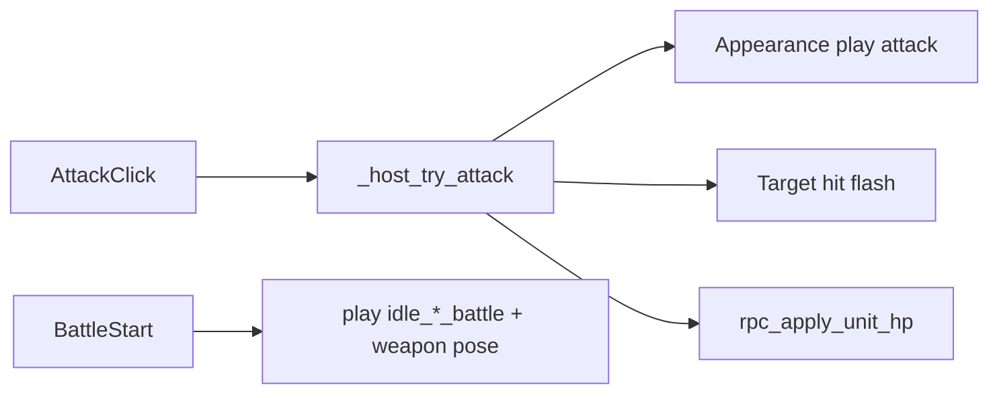

# Plan — Kampf-Feel (Battle Idle, Waffen-Pose, Attack-Feedback)

Abhak-Liste: Kampf soll sich **anfühlen**, nicht nur rechnen. Solo-freundlich: vorhandene Appearance-Pipeline + schlanke Attachment-Posen, kein zweites Anim-Ökosystem.

Bezug:
- Appearance-Runtime: [`scripts/characters/character_appearance.gd`](../scripts/characters/character_appearance.gd)
- Szene/AP: [`scenes/characters/character_appearance.tscn`](../scenes/characters/character_appearance.tscn) (`*_battle` noch in AP, Idle/Walk = SpriteFrames)
- Attack-Logik: [`scripts/battle/battle_turn_controller.gd`](../scripts/battle/battle_turn_controller.gd) (`_host_try_attack`)
- Spawn: [`scripts/battle/battle_character.gd`](../scripts/battle/battle_character.gd), [`scripts/battle/battle_enemy.gd`](../scripts/battle/battle_enemy.gd)
- Appearance-Refactor: [`PLAN_CHARACTER_APPEARANCE_REFACTOR.md`](PLAN_CHARACTER_APPEARANCE_REFACTOR.md)
- Kampf-Grid: [`PLAN_KAMPFSYSTEM_GRID.md`](PLAN_KAMPFSYSTEM_GRID.md)



Reihenfolge: Leitplanken → Battle-Idle + Waffen-Pose → Attack-Clip + Hit-Feedback → optional Slash → Kurztest.

---

## 0. Leitplanken

| # | Entscheidung |
|---|--------------|
| 1 | Körper-Frames weiter über **SpriteFrames** (`play`); AP nur für **Attachment** (Pos/Rot/z_index/visible) |
| 2 | Öffentliche API bleibt `appearance.play(name)` — intern: SpriteFrames **und** passende Attachment-Pose |
| 3 | Solo-Asset-Pfad: **eine** Waffen-Grafik + Anker rotieren/spiegeln für Richtungen (wie besprochen) |
| 4 | v1 reicht **front** (Kampf schaut meist nach vorne); left/right/back nachziehen wenn Content da ist |
| 5 | Kein neues Gear-System; Waffen-Sichtbarkeit über vorhandene Appearance-Daten / Battle-Defaults |
| 6 | Kein Steam / kein neues Kampfruleset — nur Feel auf bestehendem Move/Attack/Wait |
| 7 | Alle neuen Spieler-Texte (falls HUD) in CSV + `tr()`; Debug EN ok |

- [x] Leitplanken in Status/README verlinken

---

## 1. Ist-Kurzlage

- Attack: Schaden + HP-Label + Grid-Highlight + kosmetisches Feel (`rpc_play_attack_fx`: Lunge + Hit-Flash).
- Battle startet `play("idle_front_battle")` (SpriteFrames + AP-Attachment-Pose; Fallback ohne `_battle`).
- AP-`idle_*_battle` nur noch Marker/visible/z_index (keine Frame-/animation-Tracks); Overworld-`play` stoppt AP + hide Hand/Waffen.
- Teil der Layer-`.tres` hat `idle_*_battle`; fehlende Clips → Fallback auf `idle_*`.
- Keine `attack_*` SpriteFrames / kein Slash (v1 Interim: Tween + Flash).

---

## 2. Ziel-Runtime

### 2.1 `play(clip)` erweitert

```text
play("idle_front_battle"):
  1) SpriteFrames auf Layern mit Clip (sonst Fallback idle_front)
  2) wenn AP.has_animation(clip) oder Pose-Table[clip]: Attachment anwenden
     (Marker pos/rot, weapon/hand visible + z_index)
  3) Idle/Walk ohne Pose: optional Marker reset / Waffen hide
```

**Entscheidung v1:** Attachment über **bestehende AP-Clips** `idle_*_battle` (nur Non-Frame nutzen — Frame-Tracks ignorieren oder Clips auf Marker-Tracks reduzieren). Alternativ Pose-Dict, wenn AP-Pflege zu schwer — dann AP-Idle-Battle-Frame-Tracks löschen.

- [x] `CharacterAppearance.play`: nach SpriteFrames optional Attachment-Pose anwenden
- [x] Fallback: fehlt `*_battle` auf Layer → Basis-`idle_*` / `walk_*`
- [x] `is_playing_current` / Resync bleiben konsistent

### 2.2 Battle Idle beim Spawn

- [x] `BattleCharacter` / `BattleEnemy`: nach `apply_full_data` → `play("idle_front_battle")` (statt `idle_front`)
- [x] Hand/Waffe sichtbar laut Pose (wenn Appearance Weapon-Pfade hat oder Battle-Default-Pose sie zeigt)
- [x] Slime/nur-Race: kein Crash wenn Battle-Clip fehlt (Fallback)

### 2.3 Attack-Feel

Beim erfolgreichen Host-Attack (vor/nach Damage, kurze Timeline):

- [x] Angreifer: `play("attack_front")` oder Wiederverwendung kurzer Clip; fehlt Content → kurzer **lunge** (Position-Tween am Unit) als Interim
- [x] Ziel: Hit-Feedback — `modulate` Flash (weiß/rot) 0.1–0.2 s, synced oder lokal auf allen Peers via bestehendem HP-RPC / kleinem Anim-RPC
- [x] Turn erst nach kurzem Delay advancen **oder** Feedback parallel ohne Stall > ~0.25 s (Solo: parallel + Flash, kein langes Warten)

**Entscheidung v1 Attack-Content:** Wenn noch kein Aseprite-`attack_front` existiert → **Interim:** Battle-Idle beibehalten + Angreifer-Tween + Ziel-Flash. Sobald Frames da: SpriteFrames-Clip einhängen ohne API-Wechsel.

### 2.4 Optional Slash (Slice später)

- [ ] Kleines `SlashFX` AnimatedSprite oder Sprite + AnimationPlayer am Attachment
- [ ] Spawn/Play bei Attack; Facing front zuerst
- [ ] Kein Pflicht-Asset-Blocker für DoD v1

### 2.5 Death / Corpse (vorbereitet)

- [x] `CharacterAppearance.play_death(facing)` — nutzt `death_front` / `death` wenn vorhanden, sonst Freeze
- [x] Bei HP≤0: sichtbare Leiche (Collapse + Tint + Label „tot“); blockiert Grid nicht mehr (`is_alive`)
- [ ] Content: `death_front` Frames für Slime/Race nachziehen

---

## 3. Content / Aseprite (Solo-Checkliste)

- [x] Mindestens Race (oder Body) `idle_front_battle` vorhanden prüfen; Lücken dokumentieren / Fallback
- [ ] Eine Waffe: Anker-Pose für `idle_front_battle` im AP feinjustieren (Pos/Rot/Spiegel)
- [ ] Optional: 3–5 Frames `attack_front` auf Race/Body; gleiche Frame-Counts wo gelayert
- [ ] Slash-Strip optional separat

---

## 4. Netz / Autorität

- [x] Feel-Trigger an Host-Attack koppeln; Clients sehen Feedback über RPC (erweitere `rpc_apply_unit_hp` oder `rpc_play_attack(attacker_id, target_id)`)
- [x] Keine Gameplay-Abweichung: Schaden bleibt host-autoritativ; Feel ist kosmetisch
- [x] Late-Join: Units wieder `idle_*_battle`, kein hängender Attack-State

---

## 5. Empfohlene Slice-Reihenfolge

1. Leitplanken + dieser Plan  
2. **`play` + Attachment-Pose** + Battle-Spawn `idle_front_battle` — erledigt  
3. **Hit-Flash + Angreifer-Feedback** (Tween und/oder Attack-Clip) + Sync — erledigt  
4. AP-Battle-Clips auf Marker-Tracks entschlacken (Frame-Duplikate raus) — erledigt  
5. Optional Slash-VFX  
6. Kurztest + Status/README  

---

## Kurztest

- [ ] Fight starten: Party/Enemy in Battle-Idle, Waffe/Hand sinnvoll sichtbar (wo Content)
- [ ] Slime/ohne Weapon: kein Error, Idle ok
- [ ] Attack: sichtbares Feedback Angreifer + Ziel; HP stimmt weiter
- [ ] Multiplayer: Client sieht Feedback; Host-Autorität unverändert
- [ ] Leave/Ende Fight: keine hängenden Tweens/Modulationen
- [ ] Overworld Idle/Walk unverändert (SpriteFrames, keine Regression)

---

## Definition of Done

- [x] Kampf startet in Battle-Pose (nicht reines Overworld-Idle)
- [x] Waffen-Anker werden zur Laufzeit für Battle-Idle gesetzt
- [x] Jeder erfolgreiche Angriff hat sichtbares Feedback (mind. Hit-Flash)
- [x] Public Appearance-`play` bleibt Call-Site-freundlich
- [x] Plan-Checkboxen + Status/README aktuell

---

## Verweise

- Appearance: [`PLAN_CHARACTER_APPEARANCE_REFACTOR.md`](PLAN_CHARACTER_APPEARANCE_REFACTOR.md)
- Kampf: [`PLAN_KAMPFSYSTEM_GRID.md`](PLAN_KAMPFSYSTEM_GRID.md)
- Status: [`project_current_state_v_2.md`](project_current_state_v_2.md)
