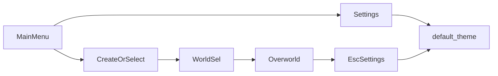

# Plan — Menü, Settings, Einstieg & Fantasy-UI-Theme

Abhak-Liste: Menü-Funnel festigen/erweitern, Settings persistieren, Charaktererstellung & Einstieg polieren, **Theme/Schrift** fantasy-tauglich und moderner machen — ohne den Flow aufzublähen.

Bezug:
- UI-Scenes: [`scenes/ui/`](../scenes/ui/)
- Scripts: [`scripts/ui/`](../scripts/ui/)
- Theme: [`resources/themes/default_theme.tres`](../resources/themes/default_theme.tres) (global via `project.godot` → `gui/theme/custom`)
- Font: [`assets/ui/PlayfairDisplay-Medium.ttf`](../assets/ui/PlayfairDisplay-Medium.ttf) (SIL OFL)
- Locale: [`autoload/locale_manager.gd`](../autoload/locale_manager.gd), [`localization/translations.csv`](../localization/translations.csv)
- Alt-Notizen: [`TODOS_nach_den_Base_Funktionen.txt`](TODOS_nach_den_Base_Funktionen.txt)

Reihenfolge: Theme-Fundament → Settings-Persistenz/Bugs → Creation festigen → Entry-Robustheit → Continue/Delete → Kurztest.

---

## 0. Leitplanken

| # | Entscheidung |
|---|--------------|
| 1 | Funnel bleibt: Main Menu → Create/Select → World Selection (Host/Join) → Overworld |
| 2 | Ein globales Theme (`default_theme.tres`); keine Massen-`theme_override_*` pro Button |
| 3 | Fantasy-Look: warmes Gold/Pergament auf dunklem Panel — **kein** Purple-Glow-Default |
| 4 | Playfair bleibt Display-/Titel-Font; Body/UI ggf. zweite lesbare Font (oder Playfair klein belassen, wenn Solo-Aufwand klein bleiben soll) |
| 5 | Alle neuen Spieler-Texte in `translations.csv` (`en`/`de`) + `tr()` |
| 6 | Settings: ein `user://settings.cfg` (Locale schon da; Sections `audio`/`video`/`input` ergänzen) |
| 7 | Kein Steam/PvP-Menü in diesem Plan |

- [x] Leitplanken in Status/README verlinken

---

## 1. Ist-Kurzlage

### Funnel
- Spielbar und kurz; Join-IP-Dialog und Host-Fail-Message existieren.
- Schwach: Load-Fehler ohne UI, Join-Fail stumm, kein Continue/Delete, WorldState im Entry kaum genutzt.

### Settings
- General (Sprache, persistiert), Audio (Master, nicht persistiert), Video (Res/FS, nicht persistiert), Controls (Walk-Rebind, nicht persistiert).
- Bug: Move-Up-Button `metadata/action_name = "walk_down"` in [`settings_popup.tscn`](../scenes/ui/settings_popup.tscn).

### Creation
- AppearanceCatalog + Preview ok; Save-Bootstrap dick im UI-Script.
- Leerer Name nur `push_warning`; Liste hard-coded `"lvl:"` / `"Unknown"`.

### Theme / Schrift
- `default_theme.tres` ist **minimal**: Default-Font Playfair 12, Gold-Textfarbe für Button/Label, Panel-Style quasi transparent (`bg_color` alpha 0).
- Viele Scenes setzen Font per `theme_override_fonts` doppelt zum Theme.
- Keine Hover/Pressed/Focus-Styles, keine LineEdit/Slider/Popup-Styles → Godot-Defaults wirken „Engine-UI“, nicht Fantasy.
- Main-Menu-Hintergrund-Art existiert; Panel/Buttons wirken flach und generisch daneben.

---

## 2. Fantasy-Theme & Schrift

Ziel: **ein** Theme, das Main Menu, Settings, Creation, World Selection, ESC und Dialoge sofort moderner und fantasy-näher wirken lässt.

### 2.1 Visuelle Richtung (fest)

| Token | Richtung |
|-------|----------|
| Panel | Dunkles, leicht transparentes Panel (Ink/Charcoal), feiner Gold-Rand, kleine Eckenradius |
| Button normal | Dunkler Fill, Gold-Text, dezenter Border |
| Button hover/pressed | Hellerer/ Gold-Glow-Rand (ohne Neon), Text etwas heller |
| Button disabled | Desaturiert, niedrige Alpha |
| Label / Titel | Gold–Pergament; Titel größer (18–28), Body 11–14 |
| LineEdit | Dunkler Inset, Gold-Caret/Border focus |
| HSlider | Track dunkel, Grabber gold/amber |
| Fokus | Sichtbarer Focus-Style (Pad/Controller später) |

Schrift:
- **Display:** Playfair Display (bereits im Projekt) für Titel / Hauptbuttons.
- **Body (empfohlen):** eine zweite, OFL-freundliche Sans oder lesbare Serif nur für lange Texte/Settings-Labels — **oder** v1 nur Playfair mit klaren Size-Typen (`font_size` im Theme), um Asset-Aufwand klein zu halten.
- **Entscheidung v1:** Theme-Typen `Header`/`Body` über Font-Sizes (+ optional `Bold`-Variante später); zweite Font-Datei nur wenn Lesbarkeit bei 12px leidet.

### 2.2 Umsetzung Theme

- [x] [`default_theme.tres`](../resources/themes/default_theme.tres) ausbauen: `Button` (normal/hover/pressed/disabled/focus), `Panel`/`PanelContainer`, `Label`, `LineEdit`, `HSlider`, `CheckBox`/`OptionButton` soweit genutzt
- [x] StyleBoxFlat-Farben als nachvollziehbare Palette (Kommentar im Plan / kurze Notiz in Theme oder `_dev`); keine per-Scene Farb-Overrides außer Ausnahme-Hintergründe
- [x] Redundant `theme_override_fonts/font = Playfair` in UI-Scenes entfernen, wo Theme greift ([`main_menu.tscn`](../scenes/ui/main_menu.tscn), [`settings_popup.tscn`](../scenes/ui/settings_popup.tscn), Creation, …)
- [x] Main-Menu-Titel: größere Font-Size / eigener Label-Theme-Type; Buttons einheitlich ohne `scale`-Hacks wo möglich
- [x] Settings-/ESC-/Join-Dialoge: gleiches Theme (bereits global — nach Theme-Update optisch mitziehen)
- [ ] Optional v1.1: dezentes Panel-Background-Texture (9-patch) statt nur Flat — nur wenn Flat nicht „fantasy genug“ wirkt

### 2.3 Nicht-Ziele Theme

- Kein komplettes Redesign jedes Ingame-HUD-Widgets in Slice 1 (Quest-Panel kann später nachziehen).
- Keine animierten Shader-Buttons.
- Kein neues Icon-Set Pflicht.

---

## 3. Settings — Persistenz & Inhalt

### 3.1 Bugs / Fundament

- [x] Move-Up-Rebind: `metadata/action_name` → `walk_up`
- [x] Control-Buttons beim Open aus aktueller `InputMap` beschriften
- [x] Audio/Video/Input beim Open aus CFG laden und UI syncen

### 3.2 Persistenz

- [x] `user://settings.cfg` erweitern (neben Locale):
  - `[audio]` master_linear / bus
  - `[video]` width, height, fullscreen
  - `[input]` Event-Serialisierung für rebindbare Actions (mindestens Walk)
- [x] Apply on change + Save; ESC/Main teilen dieselbe Logik (kleines Helper-Script oder LocaleManager → `GameSettings`/`SettingsStore`)

### 3.3 Erweiterungen (nach Persistenz)

- [x] Music- + SFX-Slider (Bus-Layout falls noch flach: Master/Music/SFX anlegen)
- [ ] Mute-Toggle optional
- [x] „Reset Controls“ auf Projekt-Defaults
- [x] Video: Werte beim Start der App aus CFG anwenden (nicht erst wenn Settings geöffnet)

---

## 4. Charaktererstellung festigen / erweitern

### 4.1 Festigen

- [x] Sichtbarer Fehler bei leerem Namen (`tr("ui.character_creation.name_required")` o. ä.)
- [x] Namenslänge + Sanitize (keine Pfadzeichen)
- [x] Preview in `_ready` auf Katalog-Index 0 (oder Random) setzen
- [x] Bootstrap aus UI → `PlayerPartyState.create_new_character(...)` (oder kleiner Helper); UI nur Input/Preview/Validation

### 4.2 Erweitern

- [x] Randomize-Appearance-Button
- [ ] Optional: „Create & Play“ (nach Save direkt Host → Overworld)
- [x] Character-List: Level-String `tr()`; Sortierung nach `updated_unix`

---

## 5. Einstieg / World Selection

### 5.1 Festigen

- [x] `load_from_disk` Return prüfen + Fail-Dialog (`tr`)
- [x] Guard leeres `selected_character_id`
- [x] Join-Fail als UI-Meldung; optional Port im Dialog (Default 4242)
- [x] `WorldState.load_from_disk` im Host/Join-Pfad wo sinnvoll

### 5.2 Erweitern

- [x] **Continue:** letzte `selected_character_id` in Settings speichern; Main-Menu-Button wenn Save existiert
- [x] Delete Save + ConfirmDialog in Character-List
- [x] Kurzer „Connecting…“-Zustand beim Join

### 5.3 Optional (später / eigener Slice)

- [x] Dünner `GameEntry`/`SessionBootstrap`-Helper (Load Party+World → Lobby → Scene), Menü-Scripts entlasten

---

## 6. Empfohlene Slice-Reihenfolge

1. **Theme v1** — `default_theme.tres` ausbauen, Overrides aufräumen, Main Menu + Settings optisch prüfen  
2. **Settings-Persistenz + Controls-Bug** + Apply-on-boot Video/Audio  
3. **Creation** Validation + Bootstrap-Extraktion (+ Randomize)  
4. **Entry** Load/Join-Feedback + Continue/Delete  
5. Settings-Erweiterungen Music/SFX/Reset  
6. Kurztest + Status/README  

Commits empfohlen pro Slice.

---

## Kurztest

- [ ] Main Menu / Settings / Creation / World Selection / ESC: Theme konsistent, Hover/Focus sichtbar, Text lesbar
- [ ] Sprache DE/EN sofort; keine neuen Hardcoded-UI-Strings
- [ ] Volume/Resolution/Keybind überleben Neustart
- [ ] Move-Up rebindet wirklich `walk_up`
- [ ] Creation: leerer Name → sichtbarer Fehler; gültiger Name → Save + Liste
- [ ] Host mit kaputtem/fehlendem Save → Dialog, kein Silent-Fail
- [ ] Join-Fail sichtbar; Continue (falls gebaut) lädt letzten Charakter

---

## Definition of Done

- [x] Fantasy-Theme global wirksam; UI wirkt nicht mehr wie Default-Engine-Widgets
- [x] Settings Audio/Video/Controls persistieren; Controls-Bug behoben
- [x] Creation mit Validation-Feedback; Save-Bootstrap nicht mehr nur im UI-Script verdoppelt
- [x] Entry meldet Load/Join-Fehler spielersichtbar
- [x] Plan-Checkboxen + Status/README aktuell

---

## Verweise

- Status: [`project_current_state_v_2.md`](project_current_state_v_2.md)
- Appearance: [`PLAN_CHARACTER_APPEARANCE_REFACTOR.md`](PLAN_CHARACTER_APPEARANCE_REFACTOR.md)
- Alt-Todos: [`TODOS_nach_den_Base_Funktionen.txt`](TODOS_nach_den_Base_Funktionen.txt)
