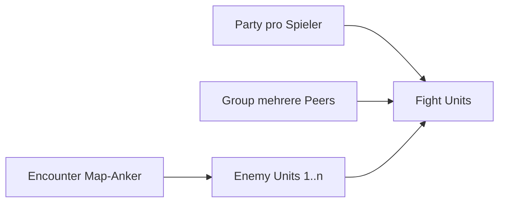
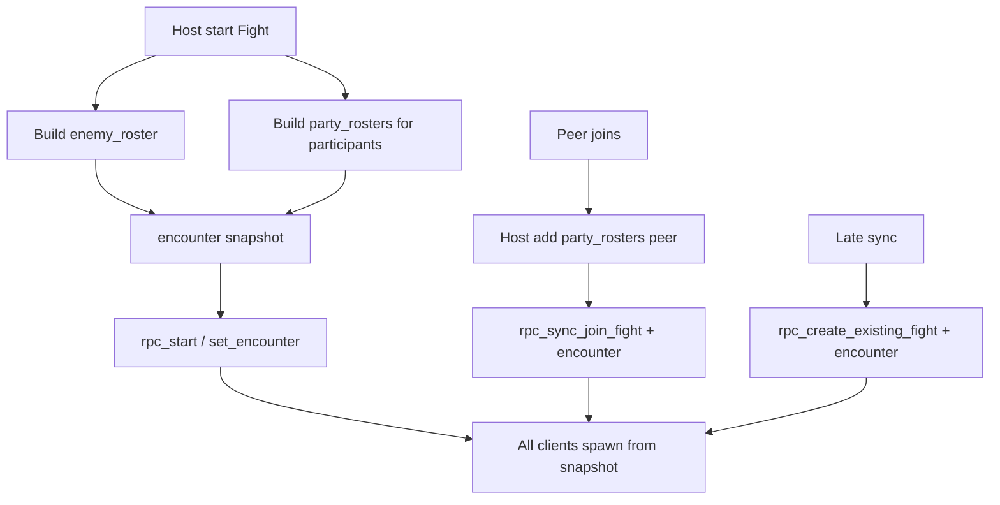

# Plan — Party / Group / Encounter

Abhak-Liste für das nächste Feature nach Quest v1: **drei getrennte Konzepte** sauber benennen und vorbereiten.

Bezug:
- Design: [`rpg_multiplayer_design_v_2.md`](rpg_multiplayer_design_v_2.md)
- Persistenz: `PlayerPartyState` (`party_data`, Autosave)
- Kampf: [`PLAN_KAMPFSYSTEM_GRID.md`](PLAN_KAMPFSYSTEM_GRID.md) — aktuell `group_size` klont denselben Gegner-Typ
- Quests: [`PLAN_QUESTSYSTEM.md`](PLAN_QUESTSYSTEM.md) — Group-Sync Stub (`_peers_in_same_group` / `share_progress_with_group`)
- Coding-Rules: [`.cursor/rules/godot-coding-standards.mdc`](../.cursor/rules/godot-coding-standards.mdc)

Reihenfolge: Begriffe festnageln → Party-Datenmodell → Encounter-Composition → Group (Multiplayer) → Fight-Anbindung → Kurztest.

---

## 0. Begriffe (verbindlich)

| EN (Code/UI-Keys) | DE (Spielertext) | Bedeutung |
|-------------------|------------------|-----------|
| **Party** | Party | Ein Spieler: Main-Charakter + Gefährten. Persistenz in `PlayerPartyState`. |
| **Group** | Gruppe | Mehrere **Spieler-Partys** in einer Session (Koop). Lobby-/Session-State, nicht Save. |
| **Encounter** | Begegnung | Map-Anker (oft 1 Sprite) → im Kampf **1..n** Enemy-Units. Content-Definition. |

**Nicht verwenden:** „Allianz“ (für später Fraktion/Diplomatie freilassen).  
**Nicht vermischen:** `group_size` am NPC ≠ Player-**Group**.



- [x] Begriffe in README / `project_current_state` kurz vermerken
- [x] CSV-Keys später mit Präfix `party.*` / `group.*` / `encounter.*` (DE+EN) — `group.*` v1

---

## 1. Architektur-Entscheidungen (v1)

| # | Thema | Entscheidung |
|---|--------|--------------|
| 1 | Party | Daten in `PlayerPartyState.party_data`; Overworld zeigt vorerst nur Main; Fight synct **Party-Roster pro Peer** (siehe §5) |
| 2 | Group | Host-autoritativ; Autoload oder Manager `GroupManager`; Peers teilen `group_id` |
| 3 | Encounter-Content | **Composition-Liste** `units[]` (npc_type + count); Fallback: altes `group_size` = N× selber Typ |
| 4 | NPC-JSON | Bleibt **Unit-Archetyp** (Stats/Appearance/Loot). Composition liegt im Encounter-Block oder eigener Encounter-Datei |
| 5 | Map-Visual | Overworld-NPC behält **eine** Appearance (Anführer/Pack-Icon); Kampf spawnt alle Units aus Composition |
| 6 | Quest-Anbindung | `QuestManager._peers_in_same_group` liest später echte Group-Mitgliedschaft |
| 7 | Fight-Sichtbarkeit | Host-Snapshot: **alle** Fight-Participants (1…Lobby-Max) sehen denselben `enemy_roster` **und** alle `party_rosters` der Participants (inkl. Join / Late-Join). Lobby-Max aktuell konfigurierbar (Code: `lobby_members_max`, z. B. 6) — **kein** festes Limit „nur 2 Peers“. |

- [x] §1 bestätigen
- [x] Ordner vorbereiten: `resources/encounters/` (optional), ggf. `scripts/group/`

---

## 2. Party (vorbereiten)

### 2.1 Ist-Zustand

- `PlayerPartyState.party_data` mit `members[]` (Charaktererstellung füllt oft 1 Member)
- Fight nutzt praktisch `members[0].stats` + 1 Avatar pro Peer
- Gefährten unsichtbar auf der Map (bewusst)

### 2.2 Ziel-Datenmodell

```json
{
  "leader_id": "member_guid_main",
  "members": [
    {
      "id": "member_guid_main",
      "role": "leader",
      "name": "Hero",
      "appearance": { "race_path": "...", "body_path": "...", "hair_path": "...", "leg_path": "..." },
      "stats": { "health": 100, "minDamage": 8, "maxDamage": 14, "initiative": 10, "move": 3, "attack_range": 1, "level": 1 }
    }
  ],
  "max_size": 4
}
```

### 2.3 API (Skizze)

An `PlayerPartyState` oder kleinem Helper:

- `get_leader() -> Dictionary`
- `get_members() -> Array`
- `get_member(id) -> Dictionary`
- `get_party_max_size() -> int`
- `add_companion(data) -> bool` (respektiert `max_size`; Content später)
- `is_party_fight_ready() -> bool`
- `build_party_roster_snapshot() -> Array` (Daten für §5b, noch nicht Fight-verdrahtet)
- `ensure_party_data()` (öffentlicher Normalizer-Entry)

v1 Scope:

- Schema + Helper + Defaults normalisieren (wie `quest_data`)
- Kein volles Companion-Recruit-UI
- Fight: Multi-Unit-Spawn über `party_rosters` (§5b); Overworld weiter nur Main

- [x] `party_data`-Normalizer (`leader_id`, `members`, `max_size`)
- [x] Query-API an `PlayerPartyState`
- [x] Charaktererstellung schreibt konsistentes Schema (inkl. `max_size`)
- [x] Party-Einheiten im Fight für alle Participants sichtbar (§5b)

---

## 3. Encounter — Composition leicht definieren

### 3.1 Problem heute

`group_size: 3` erzeugt dreimal denselben `npc_type` (gleiche Stats/Appearance). Gemischte Packs (2 Slimes + 1 Elite) sind so unbequem.

### 3.2 Empfohlenes Modell (zwei Ebenen)

**A) Unit-Archetyp** — `resources/npcs/<id>.json`  
Eine Kampf-Einheit: Stats, Appearance, Loot, `is_hostile`. Kein „wie viele“.

**B) Encounter-Composition** — Liste von Referenzen:

```json
{
  "units": [
    { "npc_type": "slime_basic", "count": 2 },
    { "npc_type": "slime_spitter", "count": 1 }
  ]
}
```

Auflösung zur Laufzeit:

1. Für jeden Eintrag Archetyp laden  
2. `count`-mal `BattleUnit` / Enemy-Node spawnen  
3. Stabile IDs: `enemy_0`, `enemy_1`, … (wie bisher)

### 3.3 Wo die Composition liegt (Autor-Freundlichkeit)

Zwei erlaubte Formen — Resolver akzeptiert beide:

**Variante 1 — Inline am World-NPC** (schnell für Biom-Spawns):

```json
{
  "name": "slime_pack",
  "is_hostile": true,
  "appearance": { "race_path": "res://features/enemy/slime/slime_basic.tres" },
  "encounter": {
    "units": [
      { "npc_type": "slime_basic", "count": 2 },
      { "npc_type": "slime_basic", "count": 1 }
    ]
  },
  "stats": { },
  "loot": { "minGold": 1, "maxGold": 4 }
}
```

`appearance` = **Map-Sprite**. Kampf-Looks kommen aus den referenzierten `npc_type`-JSONs.

**Variante 2 — Eigenes Encounter-File** (wiederverwendbar):

`resources/encounters/enc_slime_trio.json`:

```json
{
  "id": "enc_slime_trio",
  "map_npc_type": "slime_basic",
  "units": [
    { "npc_type": "slime_basic", "count": 2 },
    { "npc_type": "slime_spitter", "count": 1 }
  ]
}
```

World-Spawn / Path referenziert nur `encounter_id: "enc_slime_trio"`.

### 3.4 Rückwärtskompatibilität

Resolver-Priorität:

1. `encounter.units` / Encounter-File `units`  
2. Sonst: `group_size` (Default 1) × eigener Spec-`npc_type` (Ist-Verhalten)  
3. Fehlender Archetyp → Warning, Unit überspringen

### 3.5 Runtime / Fight

- Encounter-Dict für den Fight enthält aufgelöste Liste, z. B.  
  `enemy_roster: [ { "npc_type", "stats", "appearance", "display_name" }, ... ]`  
  (Host baut Roster einmal; **Pflicht-Sync** über Encounter-Dict bei Start/Join/Late-Join — Details §5)
- `_spawn_battle_enemies` iteriert Roster statt `for i in group_size` mit einem Appearance
- Clients dürfen Enemies **nicht** lokal neu aus Spec würfeln — nur Host-Snapshot spawnen
- Quest-Kill: weiterhin `npc_type` der besiegten Unit(s) melden (oder Encounter-Id später)

### 3.6 Warum das „leicht“ bleibt

| Autor will… | Tut… |
|-------------|------|
| 3 gleiche Slimes | `"units": [{ "npc_type": "slime_basic", "count": 3 }]` oder alt `group_size: 3` |
| Mix | mehrere Einträge in `units` |
| Pack wiederverwenden | `resources/encounters/*.json` + `encounter_id` |
| Neuen Gegner-Typ | nur neues `resources/npcs/*.json` |

Kein Editor-Zwang in v1 — reines JSON.

- [x] `EncounterResolver` (oder Funktionen in FightManager): Spec/ID → `enemy_roster`
- [x] Schema dokumentieren (`units[].npc_type`, `units[].count` ≥ 1)
- [x] Mindestens 1 Demo-Encounter mit `count > 1` und idealerweise 2 Typen (wenn 2 Specs existieren) oder 3× slime
- [x] `fight_template._spawn_battle_enemies` auf Roster umstellen
- [x] Alte Specs mit nur `group_size` weiter lauffähig
- [x] Optional: Ordner `resources/encounters/` + Loader
- [x] `enemy_roster` in Start-/Join-/Late-Join-RPCs mitsenden (siehe §5)

---

## 4. Group (Spieler ↔ Spieler)

### 4.1 Ziel v1

- Invite / Accept / Leave / Kick (Host der Group oder Leader)
- Max-Größe (z. B. 3–4 Partys)
- Jeder Peer kennt `group_id` + Member-Peer-IDs
- Disconnect entfernt Peer aus Group
- QuestManager: `_peers_in_same_group(a, b)` → echte Prüfung

### 4.2 Autorität

- **Host der Lobby/Session** validiert Group-RPCs (wie Fight)
- Group-Leader = Einladender (kann vom Session-Host abweichen — in v1 Leader = Inviter, Sync über Host)

### 4.3 API (Skizze) — `GroupManager` Autoload

- `create_group() -> group_id`
- `invite(peer_id)` / `accept_invite` / `decline_invite`
- `leave()` / `kick(peer_id)`
- `get_members() -> Array[int]`
- `is_grouped_with(peer_id) -> bool`
- Signal `group_changed`

### 4.4 UI (minimal)

- Overworld: Interaktion mit nahe Peer → **Group**-Aktion (Invite)
- HUD: kleine Member-Liste / F3 Debug: Group-Info + Force Invite (EN)

### 4.5 Was Group bewusst nicht ist

- Kein gemeinsames Inventar
- Kein gemeinsamer Party-Save
- Kein automatisches gemeinsames Fight-Start (kann folgen: „Group startet Encounter zusammen“)

- [x] `GroupManager` Autoload + RPCs
- [x] Invite-Flow UI (oder zuerst nur F3)
- [x] Disconnect-Cleanup
- [x] QuestManager Stub durch echte Membership ersetzen
- [x] CSV `group.*` (Invite/Leave/…)

---

## 5. Fight-Sync (Multiplayer) — Enemies + Party-Units

Ziel: Jeder Fight-Teilnehmer (Start, Join, Late-Join) sieht **dieselben Enemies** und **alle Party-Units aller Participants** (eigene + fremde). Clients raten nichts aus lokalem Save nach.

### 5.1 Ist-Zustand (knapp)

- Encounter wird bei Start/Join/`sync_active_fights_to_peer` mitgeschickt
- Host hält `enemy_roster` + `party_rosters` (Client-Snapshot / Host-local / Leader-Fallback)
- Legacy `player_appearances` / `player_stats` bleiben als Fallback

### 5.2 Host-Snapshot im Encounter-Dict

Host baut und hält (einmalig beim Fight-Start, Update bei Join):

```text
encounter = {
  enemy_roster: [ { unit_key, npc_type, stats, appearance, display_name }, ... ],
  party_rosters: {
    "1": [ { member_id, role, name, appearance, stats }, ... ],   // peer_id als String
    "2": [ ... ]
  },
  // legacy / Übergang:
  player_appearances, player_stats
}
```

Regeln:

1. **Nur Host** erzeugt `enemy_roster` (Resolver) und sammelt `party_rosters[peer]` aus dem jeweiligen Party-Save (lokal am Host-Peer) bzw. aus Client-Push wenn der Host fremde Party nicht lesen kann  
2. Clients spawnen Units **nur** aus diesem Snapshot  
3. Bei **Join**: Host merged neuen Peer in `party_rosters`, synct Encounter erneut an alle Participants (bestehende Join-RPC-Pfade erweitern)  
4. **Late-Join Spectator/Participant**: `rpc_create_existing_fight` / `sync_active_fights_to_peer` sendet volles Dict inkl. beider Roster  
5. Unit-IDs stabil: Enemies `enemy_0…n`; Party `player_<peer>_<member_id>` (Turn-Order / Sync)



### 5.3 Party-Roster-Quelle (Host kennt fremde Saves nicht)

Problem: `PlayerPartyState` ist lokal — Host kann Party von Peer B nicht aus dem Save lesen.

v1-Lösung (an bestehende Appearance-Sync anlehnen):

- Beim Fight-Start / vor Join: Authority-Peer sendet **Party-Snapshot** an Host (`rpc_id(1, …)`), Host schreibt `party_rosters[peer]`
- Oder: Erweiterung von `_enrich_encounter_player_data` → `_enrich_encounter_party_rosters`, gefüllt aus Request-Payload des Clients
- Fallback: fehlt Snapshot → Roster = nur Leader aus `player_appearances`/`player_stats` (heutiges Verhalten)

### 5.4 Spawn auf allen Peers

- Enemies: aus `enemy_roster` (alle Participants sehen N Gegner)
- Pro Participant: aus `party_rosters[peer_id]` Battle-Units spawnen (Leader + Companions)
- Gilt für **beliebig viele** Participants bis Lobby-/Fight-Cap — nicht nur 2
- Joiner sieht sofort bestehende Enemies **und** Party-Units aller schon drin; bestehende Peers sehen nach Sync die Party des Joiners

### 5.5 Scope-Phasen (damit es bau bar bleibt)

| Phase | Inhalt |
|-------|--------|
| **5a Encounter-MP** | `enemy_roster` Host-only + Sync Start/Join/Late-Join (auch wenn Party noch 1 Unit/Peer) |
| **5b Party-MP** | `party_rosters` + Multi-Unit-Spawn; Client→Host Party-Snapshot |

Overworld: weiter nur Main sichtbar — Sync betrifft **Fight-Instanz**.

- [x] `enemy_roster` im Encounter; Spawn nur aus Snapshot
- [x] Start-/Join-/Late-Join-RPCs: Roster immer mitsenden
- [x] Kurztest (≥2 Peers): gleicher Enemy-Count/Looks nach Join
- [x] Party-Snapshot RPC Client→Host
- [x] `party_rosters` anreichern + Multi-Unit-Spawn pro Peer
- [x] Kurztest: Peer A mit ≥2 Members, weiterer Peer joint → alle Participants sehen alle Party-Units + Enemies
- [x] Turn-Order / Unit-IDs für Party-Companions stabil
- [x] Design skaliert mit Lobby-Max (kein Hardcode auf 2 Peers)

---

## 6. Schnittstellen Kampf / Quest / Map

| System | Party | Group | Encounter |
|--------|-------|-------|-----------|
| Overworld | 1 sichtbarer Main | Invite nahe Peer | 1 Map-NPC / Symbol |
| Fight | N Units / Peer via `party_rosters` (§5) | Join/Verstärkung wie heute; später Group-Auto-Join | `enemy_roster` Host-Snapshot (§5) |
| Quests | Fortschritt in Party-Save | Progress-Share Stub → echt | Kill nach `npc_type` |

- [x] Fight: Roster statt reines `group_size`-Klonscript
- [x] Fight: Party-/Enemy-Sync §5 (5a Enemy + 5b Party)
- [x] Quest: Group-Membership verdrahten
- [x] Docs: Kampfplan-Hinweis „Encounter Composition“ auf diesen Plan verlinken

---

## 7. Empfohlene Umsetzungsreihenfolge

1. Begriffe + dieser Plan (§0–§1) — erledigt
2. **Party-Normalizer + API** (Datenbasis) — erledigt
3. **EncounterResolver + `enemy_roster` + MP-Sync 5a** — erledigt
4. **Party-Roster Sync 5b** (Snapshot + Multi-Unit-Spawn) — erledigt
5. **GroupManager** (Invite/Leave) + Quest-Hook — erledigt
6. Kurztest (inkl. Multi-Peer Fight, mind. 2 als Smoke) + README / Status — erledigt

---

## Nicht in v1 (aber Nahtstellen offen)

| Später | v1-Naht |
|--------|---------|
| Gefährten auf der Map sichtbar | Party-Members in Daten + Fight-Roster |
| Gewichtete Random-Encounters | `units` fest; später `weight` / Tables |
| Group startet gemeinsamen Fight | Group-Membership querybar |
| Gilde / Allianz | eigener Scope; Name freigehalten |
| Encounter-Symbol über Gegner | Map-NPC bleibt Trigger |

**In v1 / Folge-Slices dieses Plans enthalten:** Enemy-Roster-Sync für alle Participants; Party-Multi-Unit im Fight inkl. Sichtbarkeit für Joiner (§5).

---

## Kurztest-Checkliste

- [ ] Spec nur mit `group_size: 3` → 3 gleiche Gegner im Fight (Kompatibilität)
- [ ] Spec/Encounter mit `units: [{slime,2},{slime,1}]` → 3 Units (oder Mix wenn 2 Typen)
- [x] Map zeigt weiter 1 Sprite; Fight hat N Enemies
- [x] **Multi-Peer (Smoke: 2, Ziel: bis Lobby-Max):** nach Join sehen alle Participants denselben Enemy-Roster
- [x] **Multi-Peer:** Party A (2+ Members) im Fight; weiterer Peer joint → alle sehen alle Party-Units aller Participants
- [ ] Late-Join / Re-Sync: Roster vollständig, keine fehlenden Companions (unabhängig von Peer-Anzahl)
- [x] Party-Save hat leader + members; Helper lesen korrekt
- [x] Zwei Peers: Invite → gleiche `group_id`; Leave trennt
- [x] QuestManager erkennt Group-Peers (Debug/Log reicht zuerst)
- [x] Sprache: neue UI-Strings über CSV (`group.*`)

---

## Definition of Done (erster Slice)

- [x] Begriffe Party / Group / Encounter sind im Plan und Status-Docs konsistent
- [x] Encounter-Composition (`units[]`) auflösbar + im Fight gespawnt; `group_size`-Fallback lebt
- [x] `enemy_roster` host-autoritativ für Start/Join/Late-Join synchron
- [x] Party-Datenmodell normalisiert + Query-API
- [x] `party_rosters` sync + Multi-Unit sichtbar für alle Fight-Peers
- [x] Group invite/leave spielbar (UI oder F3)
- [x] Keine Vermischung der drei Konzepte in Code-Namen

---

## Verweise

- Kampf: [`PLAN_KAMPFSYSTEM_GRID.md`](PLAN_KAMPFSYSTEM_GRID.md)
- Quests: [`PLAN_QUESTSYSTEM.md`](PLAN_QUESTSYSTEM.md)
- Design: [`rpg_multiplayer_design_v_2.md`](rpg_multiplayer_design_v_2.md)
- Status: [`project_current_state_v_2.md`](project_current_state_v_2.md)
